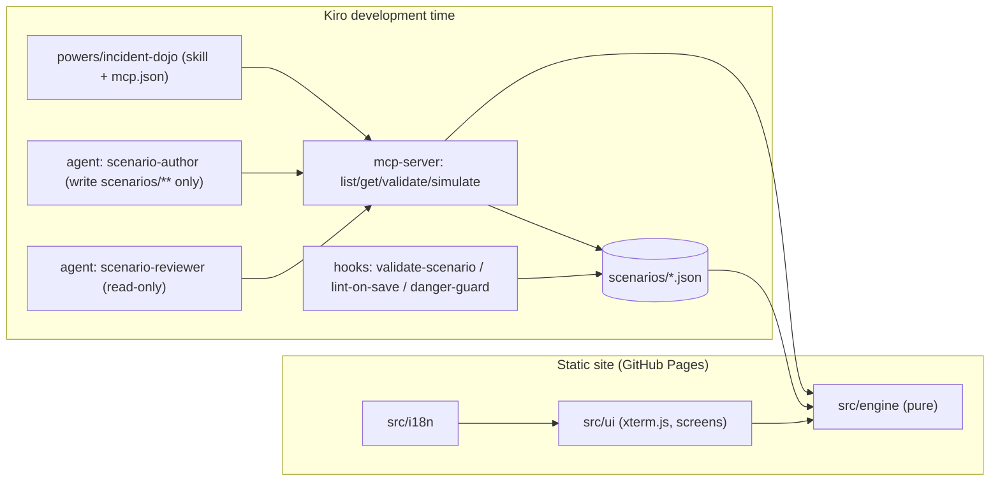
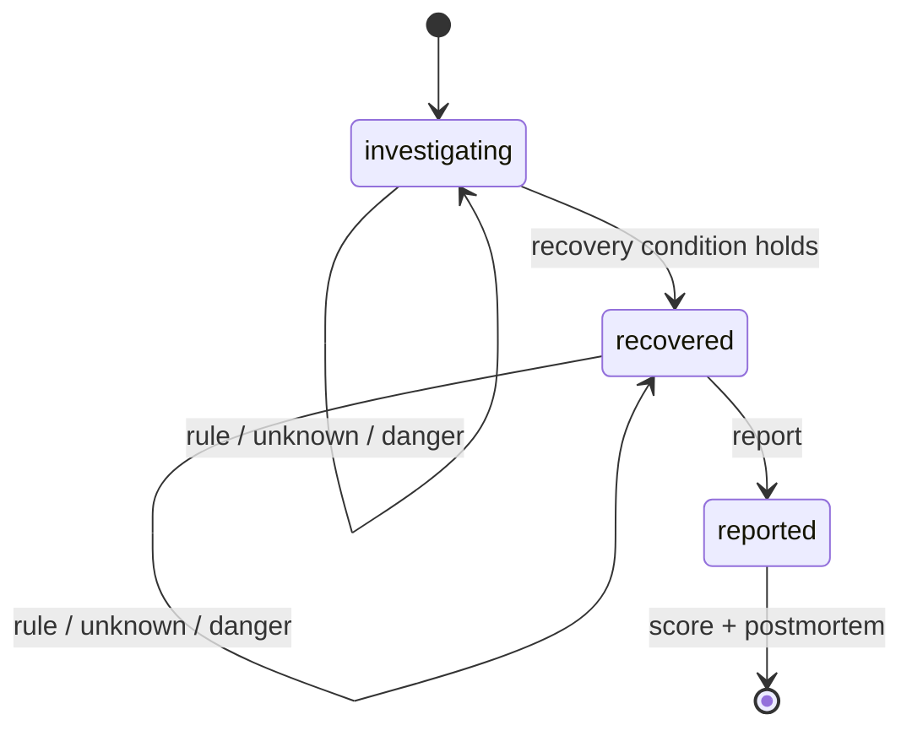

# Design Document

## Overview

Incident Dojo is a static Vite + TypeScript app. All game logic lives in a pure engine
(`src/engine`) that is shared by three hosts:

1. the browser UI (xterm.js terminal + DOM screens),
2. the MCP server used by Kiro agents (`mcp-server/`),
3. the Node validation script run by hooks and CI (`scripts/validate-scenarios.ts`).

## Architecture



## Game state machine



## Components and Interfaces

### `src/engine/schema.ts`
zod schema for `Scenario`. Types are inferred from the schema (`z.infer`).

### `src/engine/parser.ts`
- `normalizeInput(raw: string): string` — trim + collapse whitespace.
- `matchesRule(rule, input): boolean` — exact or prefix matching.

### `src/engine/engine.ts`
- `createInitialState(scenario): GameState`
- `step(scenario, state, rawInput, locale): StepResult` → `{ state, output: OutputLine[], clear }`

Evaluation order inside `step`:
1. If phase is `reported` → return state unchanged.
2. Normalize; if empty → unchanged.
3. Builtins (`help`, `hint`, `causes`, `report`, `clear`).
4. First applicable scenario rule.
5. Global danger patterns (`src/engine/danger.ts`).
6. Unknown command.

### `src/engine/scoring.ts`
- `computeScore(scenario, state): ScoreBreakdown` — penalties per Requirement 5, clamped.
- `rankFor(score): 'S' | 'A' | 'B' | 'C'`.

### `src/engine/postmortem.ts`
- `buildTimeline(state): TimelineEntry[]`
- `renderPostmortem(scenario, state, locale): string` (Markdown)

### `src/engine/validate.ts` / `reachability.ts`
- `findRecoveryPath(scenario): Rule[] | null` — BFS over flag states, non-danger rules only.
- `validateScenario(json: unknown): ValidationResult` — schema + semantic checks.
- `solutionCommands(scenario): string[]` — concrete commands of the shortest path (used by tests and `simulate_run`).

### `src/ui/*`
- `lineEditor.ts`: pure line buffer / history / tab-completion state (unit testable).
- `terminal.ts`: binds the line editor to xterm (`screenReaderMode: true`).
- `screens/*.ts`: title, select, briefing, play, result. DOM is built with
  `document.createElement` + `textContent` only.

### `mcp-server/src/*`
- `tools.ts`: pure handlers that take a scenario repository and return JSON.
- `index.ts`: wires handlers to `McpServer` over `StdioServerTransport`.

## Data Models

```ts
type LocalizedText = { ja: string; en: string };
type FlagCondition = Record<string, boolean>;   // every listed flag must equal the value

interface Rule {
  id: string;
  match: string[];                 // normalized strings
  matchType?: 'exact' | 'prefix';  // default exact
  when?: FlagCondition;
  output: string;                  // English CLI output
  effects?: Record<string, boolean>;
  danger?: { penalty: number; message: LocalizedText };
  note?: LocalizedText;            // postmortem timeline annotation
}

interface Scenario {
  id: string; version: 1;
  title: LocalizedText; briefing: LocalizedText;
  severity: 'P1' | 'P2' | 'P3' | 'P4'; category: 'linux' | 'aws';
  host: string;                    // fictional prompt host, e.g. "web-01"
  par: number;
  initialFlags: Record<string, boolean>;
  commands: Rule[];
  recovery: FlagCondition;
  hints: LocalizedText[];
  rootCauses: { id: string; label: LocalizedText }[];
  correctRootCause: string;
  postmortem: { summary: LocalizedText; fix: LocalizedText; prevention: LocalizedText };
}

interface GameState {
  scenarioId: string;
  phase: 'investigating' | 'recovered' | 'reported';
  flags: Record<string, boolean>;
  history: HistoryEntry[];          // every non-empty input, in order
  commandCount: number;
  dangerPenalty: number;
  hintsUsed: number;
  reportedCause: string | null;
  recoveredAt: number | null;       // history index
}
```

## Correctness Properties

Each property is implemented as a fast-check test (≥ 100 runs) in `tests/*.property.test.ts`.

| # | Property | Validates |
|---|---|---|
| 1 | **Determinism**: for any scenario and input sequence, running `step` twice yields deep-equal states and outputs. | Req 3.4 |
| 2 | **Score bounds**: for any input sequence, `computeScore(...).score` is an integer in [0, 100] and `rankFor` agrees with the thresholds. | Req 5.2, 5.3 |
| 3 | **Unknown command isolation**: for an input that matches no builtin, rule or danger pattern, the next state equals the previous one except `commandCount + 1` and one appended history entry. | Req 2.2 |
| 4 | **Recovery is monotonic**: once phase ≠ `investigating`, no later input returns it to `investigating`. | Req 4.2 |
| 5 | **No danger, no penalty**: if no history entry has kind `danger`, `dangerPenalty` is 0; otherwise it equals the sum of the recorded penalties. | Req 6.3 |
| 6 | **Timeline order**: the postmortem timeline inputs equal the normalized non-empty submitted inputs, in order. | Req 8.2 |
| 7 | **Whitespace insensitivity**: inserting extra leading, trailing or inner whitespace into every input does not change the final state. | Req 2.1 |
| 8 | **Report is terminal**: after phase `reported`, any further input leaves the state deep-equal. | Req 7.3 |
| 9 | **Line editor round-trip**: typing any printable string and pressing Enter submits exactly that string, and it becomes the most recent history item. | Req 11.1 |

Example tests complement the properties: every shipped scenario passes validation, and the
shortest solution plus the correct report reaches rank S.

## Error Handling

- Scenario loading failures in the browser are shown on the select screen per file; valid
  scenarios still load.
- The validator prints every issue with its JSON path and exits with code 1.
- MCP tools return `isError: true` with a message instead of throwing across the transport.

## Testing Strategy

- Properties for the engine and the line editor (fast-check + Vitest).
- Example tests for schema, validator, danger guard script, i18n parity, MCP handlers.
- `npm run check` = typecheck + lint + validators + tests; required before each commit.
