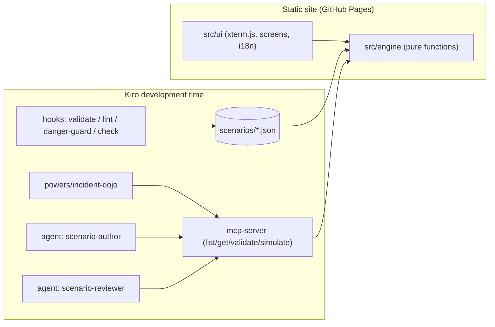

# 🥋 Incident Dojo

[日本語](#日本語) | [English](#english)

**Play:** `https://<github-user>.github.io/incident-dojo/`

---

## 日本語

架空の Linux / AWS 環境で起きた障害を、ブラウザ上の疑似ターミナルで調査・復旧する**障害対応トレーニングゲーム**です。復旧後に根本原因を報告すると、スコア（S/A/B/C）と**ポストモーテムが自動生成**されます。

### 遊び方

1. シナリオを選び、ブリーフィングを読む
2. `systemctl` / `journalctl` / `df` / `aws ...` などで調査（`help`、Tab 補完、↑↓ 履歴）
3. サービスを復旧させる（誤った対処では復旧しない「罠」が各シナリオにあります）
4. `causes` で候補を確認し、`report <id>` で原因を報告
5. スコアとポストモーテム（Markdown ダウンロード可）を確認

`rm -rf /` などの危険な操作はブロックされ、減点されます。

| シナリオ | カテゴリ | 重大度 | 学べること |
|---|---|---|---|
| `nginx-502` | linux | P2 | 502 は upstream 側の問題。デプロイで消えた設定 |
| `disk-full` | linux | P2 | 開いたままのファイルは rm しても容量が空かない（`lsof +L1`） |
| `oom-killer` | linux | P1 | 再起動ループの正体は OOM。設定変更の切り戻し |
| `alb-unhealthy` | aws | P1 | Target.Timeout は SG を疑う。0.0.0.0/0 で開けない |
| `rds-max-connections` | aws | P2 | 接続リークは DB 増強では直らない。リリースの切り戻し |

### 開発

```bash
npm ci
npm run dev                 # 開発サーバー
npm run check               # 型チェック + lint + シナリオ/Power 検証 + テスト
npm run build               # dist/ に静的サイトを出力
npm run validate:scenarios  # シナリオのスキーマ・到達可能性チェック
npm run mcp                 # MCP サーバー（stdio）を単体起動
```

### Kiro の活用

Spec / Steering / Hooks / プロパティベーステスト / Power / MCP / カスタムエージェントをすべて使っています。詳細と証跡は [CHALLENGE.md](CHALLENGE.md) を参照してください。

---

## English

An **incident response training game** that runs in the browser. Investigate and recover fictional Linux / AWS outages in a pseudo terminal, report the root cause, and get a score (S/A/B/C) plus an **auto-generated postmortem**.

### How to play

1. Pick a scenario and read the briefing
2. Investigate with `systemctl`, `journalctl`, `df`, `aws ...` and friends (`help`, Tab completion, Up/Down history)
3. Recover the service (every scenario has a trap where the obvious action does not work)
4. List candidates with `causes`, then `report <id>`
5. Review your score and the postmortem (downloadable as Markdown)

Dangerous commands such as `rm -rf /` are blocked and penalized.

### Architecture



The same pure engine powers the browser game, the MCP server and the validation script,
which is what makes the property-based tests meaningful.

### Development

See the commands in the Japanese section above (`npm run check` is the definition of done).

### Kiro usage

Specs, steering, hooks, property-based tests, a Power, an MCP server and custom agents.
See [CHALLENGE.md](CHALLENGE.md) for lesson-by-lesson evidence.

---

All hosts, companies and incidents are fictional. / 登場するホスト・企業・障害はすべて架空です。

License: [MIT](LICENSE)
